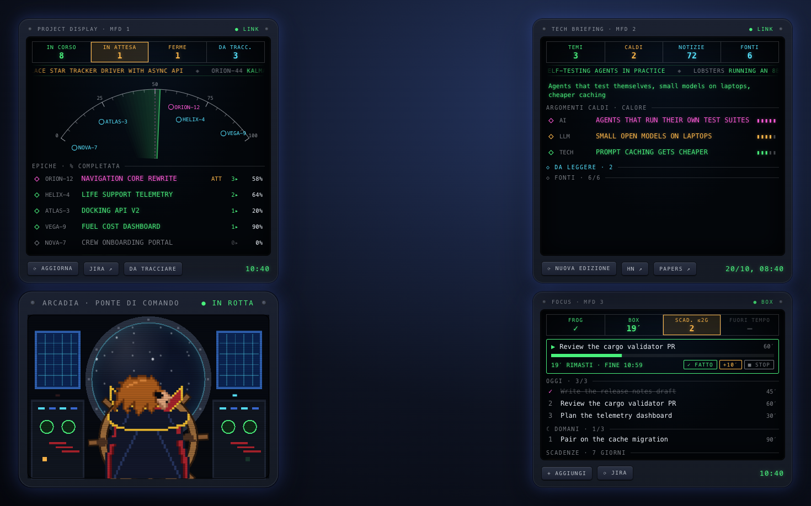
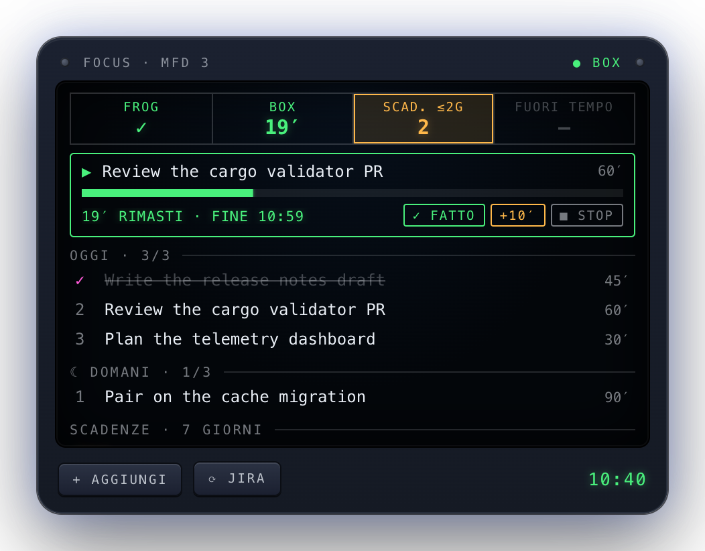

# flightdeck

**A cockpit for the working day on macOS: your Jira work, your Claude Code sessions, your focus and the
news, as instrument panels on the desktop and a pirate captain in the menu bar.**

<p align="center">
  
</p>

Four [Übersicht](https://tracesof.net/uebersicht/) widgets share one look (avionics displays: green = in
progress, amber = needs attention, magenta = focus, cyan = information) and one menu bar item
([xbar](https://xbarapp.com)) keeps the essentials one click away when windows cover the desktop.

| Part | What it is | |
|---|---|---|
| [**cc-panel**](cc-panel/) | Project display: epics, tasks in progress, Claude Code sessions waiting for you, one-click resume of any ticket in the right folder | [screenshot](docs/screenshots/cc-panel.png) |
| [**focus-panel**](focus-panel/) | Focus display: eat the frog, one time box at a time, max three items per day, deadlines for the next 7 days | [screenshot](docs/screenshots/focus-panel.png) |
| [**news-panel**](news-panel/) | Tech briefing: a daily edition on AI, LLMs and tech from public feeds, grouped in hot topics by Claude | [screenshot](docs/screenshots/news-panel.png) |
| [**harlock-panel**](harlock-panel/) | Captain Harlock at the helm of the Arcadia, in pixel art. No data, just company | [screenshot](docs/screenshots/harlock-panel.png) |
| [**harlock-bar**](harlock-bar/) | Menu bar summary: countdown, today's main tasks, tickets by epic, deadlines | [screenshot](docs/screenshots/harlock-bar.png) |

All screenshots use invented demo data (`tools/screenshots`).

## The panels

### Project display — cc-panel


- **Annunciators**: tasks in progress, Claude sessions **waiting for your answer**, stale sessions, work
  still to be tracked.
- **Navigation arc**: every epic is a waypoint on its completion percentage; a radar sweep passes over
  them and the busiest epic is your focus (magenta).
- **Epic list**: open an epic to see its tasks, the *next step* you left yourself and the repositories
  where you actually worked on it (branch, uncommitted files, unpushed commits).
- **Resume**: ▶ reopens the Claude Code session of a ticket, or starts one in the right folder with a
  brief (ticket, description, latest comments, last resume note). `/park` writes the resume note.
- **To track**: valuable work done in Claude sessions without a ticket, already phrased as a ticket
  and grouped by theme; one click creates it in Jira.

<br clear="right">

### Focus display — focus-panel



| Rule | On the panel |
|---|---|
| Eat the frog | One frog per day (◆ magenta). Until it is done, before noon, the rest is dimmed. |
| Time boxing | One box at a time on one of today's items, length chosen up front (15/30/60/90′ or the estimate). |
| Parkinson's law | Green bar, amber in the last 5′, blinking red after. One single 10′ extension. |
| Plan the day before | After 17:30 *tomorrow* appears and new items go there. |
| Next concrete action | Every item is *verb + object* with an estimate. |

At most three items per day. Unfinished items from past days go back to the parking lot: decide again
every day. Deadlines come from Jira (your open issues due within 7 days) and from local items.

<br clear="right">

### Tech briefing — news-panel


Once a day it collects the last 36 hours from public feeds and APIs (Hacker News, Lobsters, Hugging Face
papers, Simon Willison, Latent Space, Import AI, …; no HTML scraping). Claude Haiku groups them in at most
six **hot topics** with a 1-5 heat and a short summary, and picks five **reads**. If Claude does not
answer, the most voted items are shown.

<br clear="right">

### Arcadia bridge — harlock-panel


Captain Harlock at the wheel, seen from behind, looking out of the porthole while two layers of stars
scroll by. The wheel sways, hair and console lights move in steps about once a second. No shell
commands, no network; with *Reduce motion* on, the scene stands still.

<br clear="right">

## The menu bar — harlock-bar

<p align="center">
  
</p>

A pixel-art Harlock in the menu bar. Next to him: the minutes left in the current time box (amber in
the last 5′, red `+N′` when over), or `⏸N` when N Claude sessions are waiting for you. Click for:

- **Today's main tasks**: done/total and whether the open work still fits before the end of the day;
  start a countdown on any item (its estimate or 15/30/60/90′), mark done, make it the frog, move it
  to tomorrow; with a box running: done, +10′, stop. Notifications 5 minutes before the end and at the end.
- **Tickets in progress**: the ones with an open Claude session on top (waiting first), then one
  submenu per epic, **each epic in its own colour**; every ticket has its next step, Jira link and resume.
- **Deadlines** folded in one line, details in the submenu.

It reads the same data as the panels (`focus-panel show` and cc-panel's cached board), so it costs
nothing extra and works when the desktop is hidden.

## Install

Requirements: macOS, Python 3.9+ (the system `/usr/bin/python3`, no dependencies),
[Übersicht](https://tracesof.net/uebersicht/) for the panels, [xbar](https://xbarapp.com) for the menu bar.
cc-panel and the Jira deadlines need Jira Cloud with an API token; resume and the AI features need the
[Claude Code](https://docs.anthropic.com/en/docs/claude-code) CLI.

```bash
git clone https://github.com/paolacarboni/flightdeck.git ~/code/flightdeck
~/code/flightdeck/install.sh            # or only some parts: ./install.sh focus-panel harlock-bar
```

`install.sh` only creates symlinks (`~/.local/bin`, the Übersicht widgets folder, the xbar plugins folder,
`~/.claude/commands`) and never overwrites real files. Then configure Jira for cc-panel as described in
[cc-panel/README.md](cc-panel/README.md#configuration); focus-panel and harlock-bar reuse it.

**Start at login.** The panels and the menu bar exist only while Übersicht and xbar are running, so both
must open at login. On macOS 13 or later: System Settings › General › Login Items › *Open at Login* › `+`,
then add `/Applications/Übersicht.app` and `/Applications/xbar.app`. The same switch is in each app:
Übersicht › Preferences › *Launch Übersicht when I login*, xbar › Preferences › *Start at Login*.
On the first launch macOS asks to confirm opening an app downloaded from the internet: choose *Open*.

**Just looking?** In `cc-panel/widget/index.jsx` set `const DEMO = true;`: the project display shows
invented data, no Jira needed. harlock-panel needs nothing at all.

## Layout

```
flightdeck/
├── cc-panel/        Python CLI + Übersicht widget + /park command
├── focus-panel/     Python CLI + Übersicht widget
├── news-panel/      Python CLI + Übersicht widget
├── harlock-panel/   Übersicht widget only
├── harlock-bar/     xbar plugin (Python) + pixel-art icon
├── tools/screenshots/  renders the widgets with demo data in headless Chrome
├── docs/screenshots/   the images above
└── install.sh
```

Each part keeps its own state under `~/.claude/<part>/` and has its own tests:

```bash
for part in cc-panel focus-panel news-panel harlock-bar; do
  /usr/bin/python3 -m unittest discover -s $part/tests -t $part
done
```

To refresh the screenshots: `npm install --prefix tools/screenshots && npm run --prefix tools/screenshots shoot`
(needs Node and Google Chrome).

## Notes

- **Privacy.** Everything runs locally. Jira is read with your token; the only writes are the issues you
  create from *To track*. The AI features call `claude -p` (Claude Haiku, no tools) with ticket titles
  and short excerpts of your own sessions.
- **Language.** The interface is in Italian for now; translations are welcome.
- **Übersicht caveat.** A runtime error in a widget can make Übersicht's local server exit; if the panels
  disappear, restart Übersicht.
- Captain Harlock is a character created by Leiji Matsumoto. The pixel art here is an original fan
  drawing, not affiliated with the rights holders.

## License

[MIT](LICENSE)
