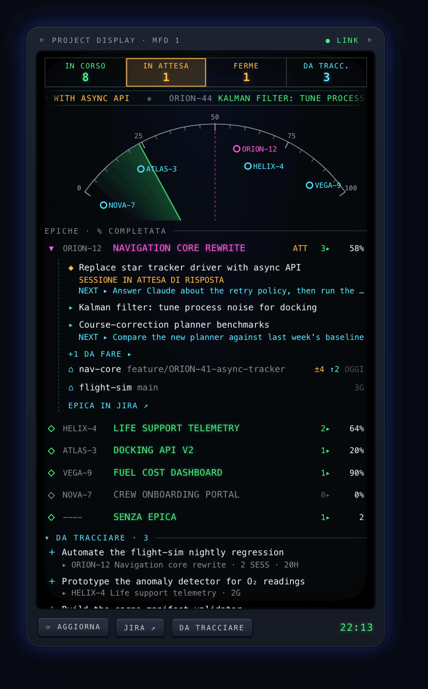

# cc-panel

**A cockpit for your Jira work and your Claude Code sessions, right on the macOS desktop.**

<p align="center">
  
</p>

When you juggle many projects with Claude Code, the hard part is not opening a session: it is
remembering *where you left off*. cc-panel keeps your epics, tasks, repositories and Claude sessions
on one glanceable instrument panel, and resumes any task with one click, in the right folder, with
the context already loaded.

## What you see

- **Annunciators** — tasks in progress, sessions **waiting for your answer** (lit in amber), stale
  sessions, work still to be tracked.
- **Navigation arc** — every epic is a waypoint placed on its completion percentage. A radar sweep
  passes over them; the epic with the most work in progress is your focus (magenta).
- **Ticker** — your tasks in progress scroll slowly under the annunciators.
- **Epic list** — open an epic to see its tasks, the *next step* you left yourself, and the
  repositories where you actually worked on it (branch, uncommitted files, unpushed commits).
- **To track** — valuable work you did in Claude sessions that has **no ticket yet**, already
  phrased as a ticket and grouped by theme. One click creates it in Jira under the right epic.

Avionics colour code: green = in progress, amber = needs attention, magenta = focus,
cyan = information and advisories.

Drag the panel by its top bar to move it anywhere on the desktop (the position is remembered);
double-click the bar to send it back to the corner.

## What it does

| | |
|---|---|
| ▶ **Resume a task** | `cc-panel start KEY` reopens the Claude session named after the ticket (open or closed). If there is none, it picks the folder from your session history and starts `claude --name "KEY title"` with a brief: ticket, description, latest comments, last resume note. |
| **/park** | A Claude Code slash command that writes a dated resume note (where, done, next step, blockers, key files) for the ticket. The next start reads it. |
| **Repos per epic** | Derived from your Claude session history, no manual mapping: sessions that mention the epic's tickets vote for their folder, weighted by how focused they are. |
| **To track** | Sessions with real work (file edits or commits) and no ticket are evaluated once by Claude Haiku against your epics. Work matching an open task is linked automatically; the rest is grouped into at most 5 themes. |
| **Stale sessions** | Open sessions idle for more than 24 h are flagged: `/park` and `/exit` them. |

## How it works

```
Desktop widget (Übersicht, WebKit) ──▶ local Übersicht server 127.0.0.1 ──▶ cc-panel (Python)
                                                                             ├─▶ Jira Cloud REST API
                                                                             ├─▶ git + Claude Code sessions on disk
                                                                             └─▶ claude -p (proposals, in background)
```

- The widget polls `cc-panel board --json` every 5 minutes (and on ⟳). Jira is only **read**;
  the only write is creating a ticket when you click *Create task / Create epic*.
- Claude Code history is read from `~/.claude/projects` and `~/.claude/sessions`, indexed
  incrementally (only changed transcripts are re-read).
- Everything stays on your machine. Übersicht's server listens on `127.0.0.1` only.

## Requirements

- macOS, [Übersicht](https://tracesof.net/uebersicht/)
- Python 3.9+ (the system `/usr/bin/python3` is enough, no dependencies)
- [Claude Code](https://docs.anthropic.com/en/docs/claude-code) CLI
- Jira Cloud with an [API token](https://id.atlassian.com/manage-profile/security/api-tokens)
- [Ghostty](https://ghostty.org) (optional; Terminal.app is used otherwise)

## Install

```bash
git clone https://github.com/<you>/cc-panel.git ~/code/cc-panel
ln -s ~/code/cc-panel/bin/cc-panel ~/.local/bin/cc-panel
ln -s ~/code/cc-panel/commands/park.md ~/.claude/commands/park.md
ln -s ~/code/cc-panel/widget ~/Library/Application\ Support/Übersicht/widgets/cc-panel.widget
```

Configure it in `~/.config/cc-panel/config.json` (see [`config.example.json`](config.example.json)):

```json
{
  "jira_base_url": "https://your-company.atlassian.net",
  "jira_email": "you@example.com",
  "default_project": "OPS",
  "notes_dir": "~/notes/jira",
  "projects_dir": "~/code"
}
```

and export your token: `export JIRA_API_TOKEN=...` (e.g. in `~/.zshrc`).

| Key | Meaning |
|---|---|
| `jira_base_url`, `jira_email` | Your Jira Cloud site and account |
| `default_project` | Project where *Create epic* puts new epics |
| `notes_dir` | Where `/park` writes `<KEY>.md` resume notes (works great inside an Obsidian vault) |
| `projects_dir` | Root of your repositories (folder suggestions, moved-folder detection) |

Every key can also be set with an environment variable (`CC_PANEL_JIRA_URL`, `CC_PANEL_JIRA_EMAIL`,
`CC_PANEL_DEFAULT_PROJECT`, `CC_PANEL_NOTES_DIR`, `CC_PANEL_PROJECTS_DIR`).

**Just want to look at it?** Set `const DEMO = true;` at the top of `widget/index.jsx`: the panel
shows invented data (the one in the animation above), no Jira needed.

## Command line

```bash
cc-panel board [--json] [--demo]     # the panel model
cc-panel start KEY [--new] [--dir PATH] [--auto]
cc-panel park KEY < note.md          # what /park uses
cc-panel track S1 S2 --epic KEY --summary "Title"   # or --new-epic
cc-panel link SESSION KEY | ignore SESSION | resume SESSION | open DIR
cc-panel digest                      # evaluate sessions for proposals (the panel runs it for you)
```

## Notes

- **Proposals use Claude.** Each candidate session is evaluated once with `claude -p --model haiku
  --no-session-persistence` (no tools): an excerpt of your messages, edited file names and commit
  count are sent, together with your epic and task titles. Roughly one cent per session, cached.
- **Language.** The interface and prompts are in Italian for now; translations are welcome.
- **Übersicht caveat.** A runtime error in a widget can make Übersicht's local server exit; if the
  panel disappears, restart Übersicht.

## Development

```bash
/usr/bin/python3 -m unittest discover -s tests -t . -v
```

## License

[MIT](LICENSE)
