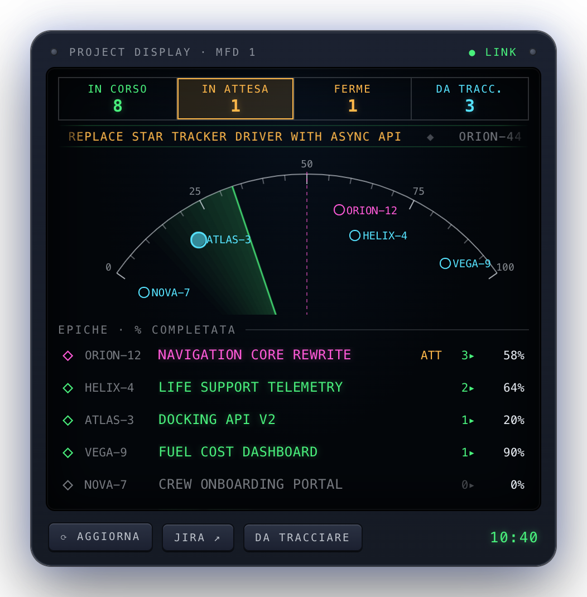

# cc-panel

**Resume work from a Jira ticket: the right Claude Code session, in the right folder, with the context
already loaded. And a cockpit panel with all your epics on the desktop.**

<p align="center"></p>

## What it does

| | |
|---|---|
| ▶ **Resume a task** | `cc-panel start KEY` reopens the Claude session named after the ticket (open or closed). If there is none, it proposes a folder and starts `claude --name "KEY title"` with a brief: ticket, description, latest comments, last two resume notes. |
| **/park** | Claude Code slash command: writes a dated resume note (where, done, next step, blockers, key files) in `<notes_dir>/<KEY>.md`. The next `start` reads it. |
| **Folder for a new ticket** | Last folder chosen for the ticket, then folders of past sessions that mentioned the ticket or its epic. For a brand-new ticket, a search over your repositories (BM25 on names, manifests, READMEs and session titles, optionally fused with multilingual embeddings) proposes the top 3 with the evidence that picked them. |
| **Repos per epic** | Derived from your Claude session history, no manual mapping, with branch, uncommitted files, unpushed commits and age of the last commit. |
| **To track** | Sessions with real work (file edits or commits) and no ticket are evaluated once by Claude Haiku against your epics. Work matching an open task is linked automatically; the rest becomes at most 5 themes, ready to be created in Jira. |
| **Stale sessions** | Open sessions idle for more than 24 h are flagged: `/park` and `/exit` them. |
| **Decision feed** | Every session's status, the important decisions it declares (`cc-panel decide`), what needs your attention, and a one-command fork to learn the concept behind a decision (`cc-panel dive ID`). See [docs/decision-feed.md](docs/decision-feed.md). |
| **Menu bar** | xbar plugin `xbar/cc-panel.10s.sh` (`cc-panel bar`): active sessions and today's decisions in the menu bar. |

The panel (top left, refreshed every 5 minutes) shows annunciators (in progress, waiting for you, stale,
to track), a navigation arc with every epic on its completion percentage, and the epic list.
The four panels sit on a fixed grid and scale with the screen.

## How it works

```
Übersicht widget ──▶ cc-panel board --json ──┬─▶ Jira Cloud REST API (read; write only on "create")
                                             ├─▶ git + Claude Code sessions on disk (~/.claude)
                                             └─▶ claude -p (proposals, in background)
```

## Configuration

`~/.config/cc-panel/config.json` (see [`config.example.json`](config.example.json)):

| Key | Meaning |
|---|---|
| `jira_base_url`, `jira_email` | Your Jira Cloud site and account |
| `default_project` | Project where *Create epic* puts new epics |
| `notes_dir` | Where `/park` writes `<KEY>.md` resume notes (works well inside an Obsidian vault) |
| `projects_dir` | Root of your repositories (default `~/Projects`) |

The token is read from `JIRA_API_TOKEN` (environment or an `export JIRA_API_TOKEN=...` line in `~/.zshrc`).
Every key can also come from an environment variable: `CC_PANEL_JIRA_URL`, `CC_PANEL_JIRA_EMAIL`,
`CC_PANEL_DEFAULT_PROJECT`, `CC_PANEL_NOTES_DIR`, `CC_PANEL_PROJECTS_DIR`.

Optional semantic folder search (once): `cc-panel semantic-setup` creates a venv in `~/.cc-panel/venv`
and downloads a pinned, sha256-verified `multilingual-e5-small` model (118 MB); `cc-panel index` builds
the repository index, which the panel then refreshes in background every 12 hours.

## Command line

```bash
cc-panel board [--json] [--demo]                     # the panel model (--demo: invented data)
cc-panel start KEY [--new] [--dir PATH] [--auto]     # resume or start the ticket's session
cc-panel park KEY < note.md                          # what /park uses
cc-panel track S1 S2 --epic KEY --summary "Title"    # or --new-epic
cc-panel link SESSION KEY | ignore SESSION | resume SESSION | open DIR
cc-panel digest | index | semantic-setup [--from DIR]
cc-panel feed [--json] [--follow]                    # live sessions, decisions, attention points
cc-panel decide "Title" --why ... --alt ... [--watch ...] [--learn ...]
cc-panel dive ID                                     # fork the session to explain a decision
cc-panel bar                                         # xbar menu (used by xbar/cc-panel.10s.sh)
```

## Files

| Path | Content |
|---|---|
| `~/.claude/cc-panel/state.json` | folder chosen per ticket, session → ticket links, ignored sessions |
| `~/.claude/cc-panel/board.json` | last panel model, used when Jira does not answer |
| `~/.claude/cc-panel/history.json`, `digest.json`, `groups.json` | session index, evaluations, proposed themes |
| `~/.claude/cc-panel/index/` | repository index |
| `<notes_dir>/<KEY>.md` | ticket note with the `## Ripresa` section |

## Tests

```bash
/usr/bin/python3 -m unittest discover -s tests -t .
```
