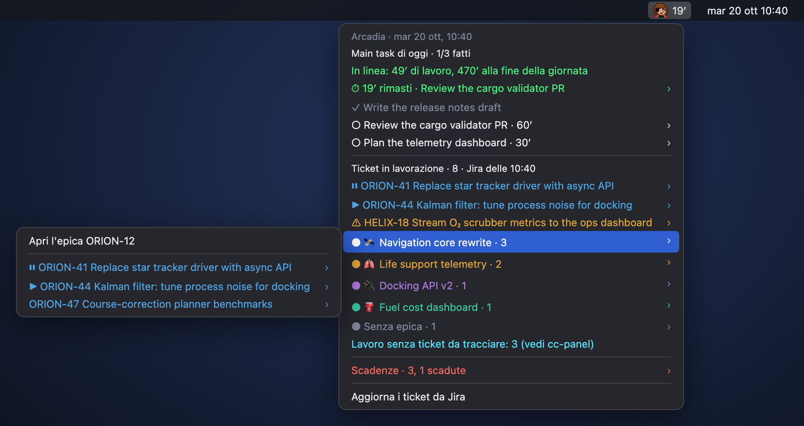

# harlock-bar

**Captain Harlock in pixel art in the macOS menu bar ([xbar](https://xbarapp.com) plugin). One click: the
summary of the desktop panels, also when windows cover them. No news.**

<p align="center"></p>

- **Title**: minutes left in the time box (amber in the last 5′, red `+N′` when over); without a box,
  `⏸N` when N Claude sessions of tickets in progress are waiting for you.
- **Today's main tasks** (focus-panel): done/total, *on track* or *behind* (open work in minutes against
  the minutes to the end of the day, 18:30 by default), the frog. On each item: start the countdown with
  the estimate or 15/30/60/90′, done, frog, to tomorrow, park. With a box running: done, +10′, stop.
- **Tickets in progress** (cc-panel): tickets with an open Claude session on top (waiting first, at most 5),
  then one submenu per epic, each epic with its own colour. Every ticket: next step, Jira, resume the
  session (`cc-panel start KEY --auto`).
- **Deadlines** (focus-panel): one line with the count, details in the submenu with links to Jira.
- Notifications 5 minutes before the end of the box and at the end (with a sound).

## Install

```bash
../install.sh harlock-bar
open -a xbar
```

Requirements: `/usr/bin/python3` (3.9+), focus-panel and cc-panel installed in `~/.local/bin`. Turn on
*Start at Login* in xbar.

## Data

The menu is rebuilt every 30 seconds from `focus-panel show` (local) and `~/.claude/cc-panel/board.json`.
If the board is older than 15 minutes, `cc-panel board --json` refreshes it from Jira in background (at
most once every 15 minutes); *Aggiorna i ticket da Jira* does it now. cc-panel rewrites the board in place,
so the last readable copy is kept in `~/.claude/harlock-bar/board.json`.

| Variable | Default |
|---|---|
| `HARLOCK_DAY_END` | `18:30` |
| `HARLOCK_FOCUS_CLI`, `HARLOCK_CC_CLI` | `~/.local/bin/focus-panel`, `~/.local/bin/cc-panel` |
| `HARLOCK_BAR_HOME` | `~/.claude/harlock-bar` (notifications already sent, last copy of the board) |

## Icon

`icon/make_icon.py` draws the 18×18 sprite (fringe, eye patch with strap, scar, red collar) and writes
`icon/harlock.png`: 40×40 pixels at 144 dpi, i.e. 20 points @2x, the face at 2 pixels per cell.

## Tests

```bash
/usr/bin/python3 -m unittest discover -s tests -t .
```
