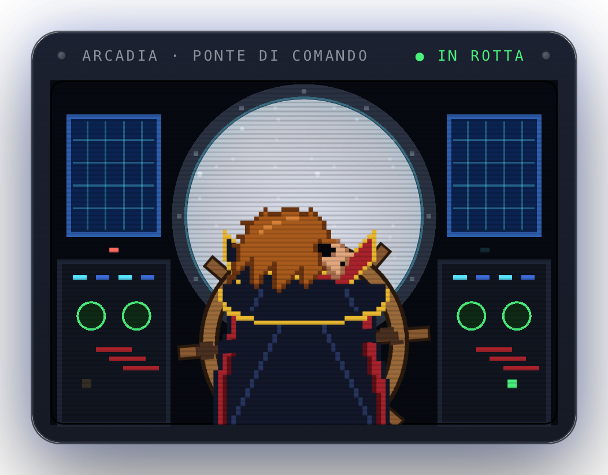

# harlock-panel

**Captain Harlock at the helm of the Arcadia, in pixel art, framed like the other panels.**

<p align="center"></p>

Harlock is seen from behind, head turned in profile towards the porthole; behind the almost transparent
glass, two layers of stars scroll by. The wheel sways slowly, head and hair move in steps, the console
lights blink.

## Cost

No shell command, no network: the scene is drawn once and moved by a timer that changes styles only when
a step changes (about once a second). WebKit does not hand `steps()` CSS animations to the GPU, so a timer
is cheaper here. With *Reduce motion* on in macOS the scene stands still.

## Install

```bash
../install.sh harlock-panel
```

Captain Harlock is a character created by Leiji Matsumoto; this is an original fan drawing.
