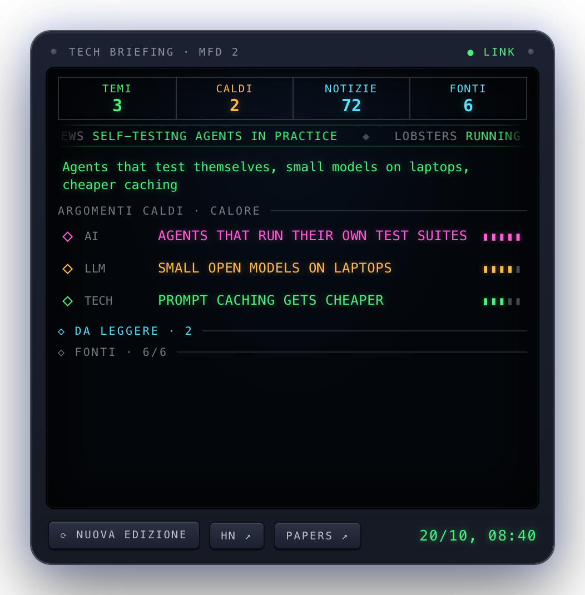

# news-panel

**A daily briefing on AI, LLMs and tech: hot topics with a 1-5 heat, a short summary, links to the
sources and a few recommended reads.**

<p align="center"></p>

## Use

```bash
news-panel fetch   # collect the news and prepare today's edition (about a minute)
news-panel show    # cached edition as JSON (used by the panel)
```

The panel (top right) reads the cache every 5 minutes. If today's edition is missing and it is past 7:00
it starts `fetch` in background; after a failed attempt it retries after an hour. *⟳ NUOVA EDIZIONE*
rebuilds it now. Click a topic to open it, an item to read it; *DISCUSS.* opens the comments
(Hacker News, Lobsters).

## Sources

Only public feeds and APIs, no HTML scraping. Items from the last 36 hours (72 for HF papers), at most
15 per source; the list is in [`news_panel/sources.py`](news_panel/sources.py).

| Area | Sources |
|---|---|
| LLM / AI | Simon Willison, Latent Space, Interconnects, Import AI, OpenAI, Google DeepMind, Hugging Face blog, r/LocalLLaMA |
| Research | Hugging Face daily papers |
| Tech | Hacker News (≥60 points), Lobsters, Techmeme, Ars Technica |

Claude Haiku (`claude -p`, no tools) groups the items in at most 6 topics and picks 5 reads, in Italian.
If it does not answer, the panel shows the most voted items.

Requirements: `/usr/bin/python3` (3.9+), `claude` in the `PATH` (or in `~/.local/bin`) for the summary.

## Files

| Path | Content |
|---|---|
| `~/.claude/news-panel/news.json` | last edition |
| `~/.claude/news-panel/fetch.lock` | collection in progress |

## Tests

```bash
/usr/bin/python3 -m unittest discover -s tests -t .
```
